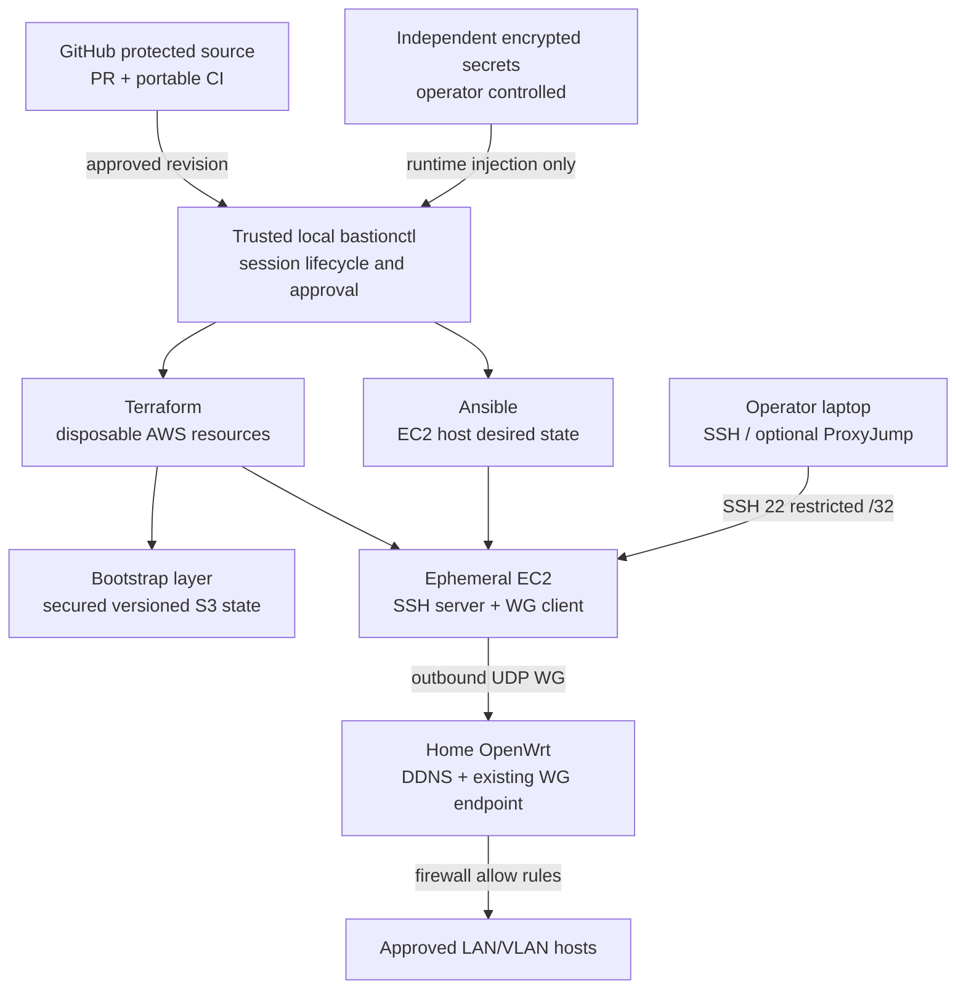

# Ephemeral AWS WireGuard Bastion

**Status: Sprint 00 repository foundation — proposed / not deployed.**

A disposable **SSH bastion on AWS EC2** connects as a **WireGuard client** to an already-reachable residential OpenWrt WireGuard endpoint (existing DDNS). The operator SSHes into EC2 or uses OpenSSH ProxyJump to reach approved home-LAN hosts. Terraform owns AWS cloud resources; Ansible owns bastion host configuration and approved home peer operations; a future trusted operator CLI coordinates ephemeral sessions. Canonical source and CI are in GitHub. **No CI job may deploy to AWS.**

See [documentation index](docs/README.md), [architecture](docs/architecture.md), [roadmap](docs/roadmap.md), [backlog](docs/backlog.md), [ADRs](docs/adr/0001-single-owner-trust-boundaries.md), and [Sprint 00](docs/sprints/00-repository-foundation.md).

## Planned architecture



All links are **proposed** until individually verified; the home WireGuard/DDNS endpoint is already reported operational and is not managed by this repo at Sprint 00.

## Boundaries

| Owner | Durable responsibility | Never owns |
|---|---|---|
| GitHub | reviewed source, CI evidence | live AWS/routers/keys |
| Terraform bootstrap | persistent S3 state and provisioning role | session EC2 |
| Terraform session | VPC, subnet, IGW, routes, SG, IAM instance profile, EC2/EBS | bastion OS config, home router |
| Ansible | OS baseline, SSH/WG client, approved home peer changes | AWS EC2 lifecycle |
| Operator CLI (future) | authentication, key injection, deployment order, teardown verification | silently overriding resource owners |

## Repository state (Sprint 00)

- [x] Proposed repo contracts, roadmap, ADRs, threat model, docs and CI gates authored (not yet merged).
- [ ] GitHub initial commit + passing hosted CI evidence.
- [ ] S0 portability/negative-test gates proven on operator machine.
- [ ] AWS account bootstrap and state backend implemented (Sprint 01).
- [ ] Terraform session stack provision/destroy verified (Sprint 02).
- [ ] Ansible baseline + WireGuard tunnel + access controls verified (Sprint 03).
- [ ] Idempotent operator CLI, cleanup and failure recovery verified (Sprint 04).

## Local validation

Stage the files you intend to commit **first**, since validation inventories files using `git ls-files`:

```bash
git add -A
bash scripts/ci/bootstrap.sh
bash scripts/ci/validate.sh
```

Bootstrap converges pinned Python tools. `validate.sh` performs syntax, lint, security/config negative tests, Ansible syntax and (once Terraform source is added) Terraform fmt/init-without-backend/validate. It **never** calls `terraform apply` or makes cloud API mutations.

Optional: `CI_COLOR=always CI_VERBOSE=true bash scripts/ci/validate.sh`.

## What is not yet included

No working Terraform `.tf` files, no deployed bastion, no live secrets, no automated home peer enrollment, and no lifecycle CLI are claimed in Sprint 00. Current Ansible playbooks are deliberately **fail-closed placeholders**, not ready-to-run configuration.

## Related ARM platform

The structure and CI conventions are adapted from [arm-homelab-platform](https://github.com/ctalaveraw/arm-homelab-platform), particularly its tracked-file validators, pinned venv bootstrap, ANSI UI, sprint evidence, ADR conventions and trust separation. Do not share runtime credentials or Terraform state between these projects. Related workstream: AWS-001 through AWS-004.
