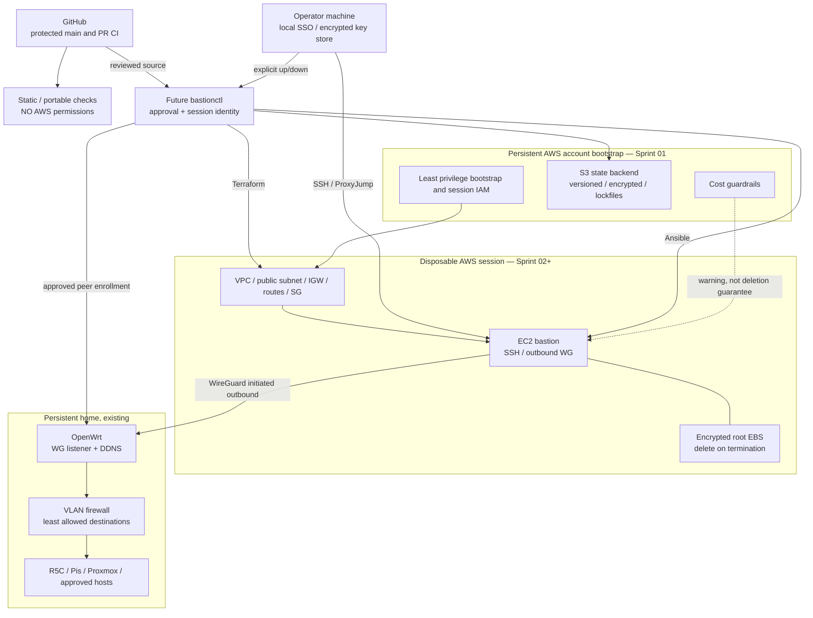
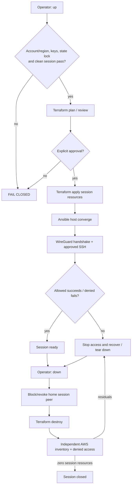

# Architecture — Source, Provisioning, Runtime, Destruction

**Status:** Designed, not deployed. Existing home endpoint and DDNS were reported operational; all AWS stages unimplemented.

## Data and control planes

## Network routing decision

- AWS bastion has inbound TCP/22 restricted to a current public IPv4 /32; there is no inbound WireGuard listener on EC2.
- EC2 connects to the existing DDNS-managed home WireGuard endpoint over outbound UDP.
- OpenWrt authenticates a dedicated client peer and routes only allowed LAN/VLAN destinations. Firewall policy—not AllowedIPs alone—enforces LAN access. The MVP uses specific approved SSH destinations before expanding to any VLAN.
- SSH ProxyJump uses the **operator's destination keys on the operator device**. No agent forwarding or SSH private-key copying to EC2 is required.
- Home DDNS/Cloudflare tokens remain on the home router; they are never injected into AWS.

## AWS identity and ownership

The initial account requires human account/root MFA and an independent temporary administrator/Identity Center login. Terraform cannot create the identity used to authenticate before that identity exists. Persistent bootstrap and disposable sessions use different states and scopes. State is sensitive, even if module inputs are public.

## Control and failure path

## Resource ownership contract

See [ADR-0001](adr/0001-single-owner-trust-boundaries.md). No competing Terraform/Ansible router edits; no automatic GitHub push-to-production; no dependence on the ARM R5C, Gitea, Kubernetes, or OpenBao to rebuild the bastion.
